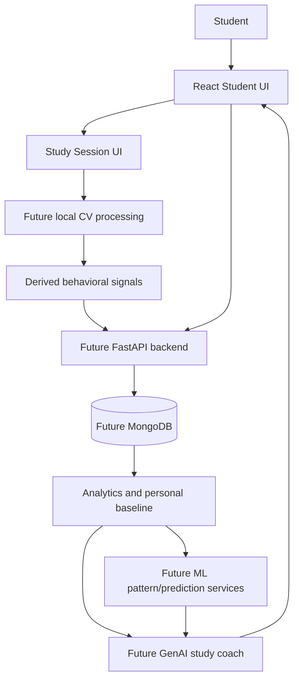
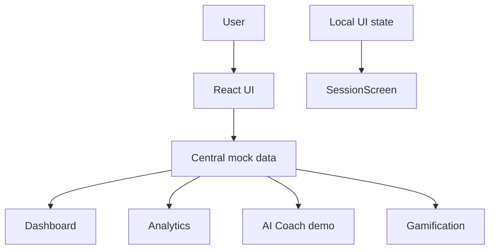

# Architecture and Delivery Phases

## Intended high-level architecture

## Current presentation architecture

No backend, database, real webcam processing, or AI inference is required for Phase 1.

## Delivery phases

### Phase 1 — Complete UI Development and Presentation
Build all student-facing screens, interactions, responsive behavior, charts, and coherent mock data. This is the only active phase.

### Phase 2 — Backend and Data
FastAPI, MongoDB, authentication, user profiles, study sessions, attention-record ingestion, analytics endpoints, and frontend API integration.

### Phase 3 — Computer Vision
Opt-in webcam flow, local processing, face presence, head pose, feasible gaze signals, potential distraction events, attention estimation, and optional YOLO object detection.

### Phase 4 — ML, GenAI, and Gamification Logic
Personal baseline, pattern analysis, prediction only if data supports it, structured-data-based AI coaching, recommendations, XP, levels, badges, streaks, and challenge rules.

### Phase 5 — Integration, Testing, Privacy, Deployment
End-to-end integration, testing, security/privacy review, Docker, deployment, and operational checks.

## Cross-module integration principles

- Frontend components should not own backend transport details.
- Define stable data contracts before connecting services.
- CV should send derived signals/metrics, not raw video by default.
- Attention scoring should be explainable and described as an estimate.
- GenAI should receive structured metrics, not raw webcam frames.
- Gamification should reward meaningful progress, not simply idle timer duration.
